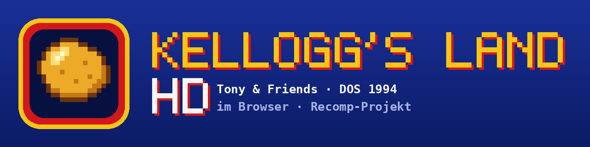

<p align="center"></p>

# Kellogg's Land HD

A browser port of **Tony & Friends in Kellogg's Land** (Factor 5 / Rauser Advertainment, DOS 1994), on its way to a full recompilation.

The original `START.EXE` runs unmodified on a small emulated PC written in JavaScript. Because the real game code runs, controls, enemies and levels behave exactly like the original. On top of that, the game's own scene data (camera, level map, tiles, sprites) is read every frame and redrawn, so the levels can be shown in 16:9 widescreen and later in HD.

**Play online:** [brummilab.github.io/kelloggs-land-hd](https://brummilab.github.io/kelloggs-land-hd/) (bring your own copy of the game, it never leaves your browser).

> **Status:** Playable in the browser with sound. New: **16:9 widescreen** (levels rebuilt from map, tiles and sprites, currently for the German release with a 147,200-byte START.EXE). Still running on the interpreter, graphics still at original resolution. See the [roadmap](ROADMAP.md).

## No game data in this repo

This repository contains **no** game files. You need your own copy (freeware, e.g. `kelloggs.zip`) with `START.EXE`, `PCKELL.DAT`, `RTM.EXE` and `DPMI16BI.OVL`. For local development put them in `game/`, which is listed in `.gitignore`. In the browser, your copy is read locally and never uploaded.

## What we know about START.EXE

`python3 tools/neinfo.py game/START.EXE`

| Property | Value |
|---|---|
| Format | NE (16-bit protected mode), Borland RTM / DPMI16 |
| Code | 5 segments, 100,610 bytes |
| Data | seg6 (28 KB initialised) + seg7 (64 KB stack/BSS) |
| Entry point | `seg1:13a1` |
| Imports | 13 KERNEL functions + 3 RTM ordinals |
| Compiler | Borland Pascal 7 (DPMI target), lots of 386 assembly |
| Graphics | Mode 13h, Mode 12h and a tweaked Mode X 360×480 (title screen) |
| Timer | Raster timing: channel 0 is reprogrammed on every IRQ, channel 2 measures time |

The imports are limited to memory (`GlobalAlloc`, `GlobalDOSAlloc` …), fixed selectors for video RAM and BIOS data (`__A000H`, `__B800H`, `__0040H`) and a code alias. That is a small surface to rebuild. Details (in German) in [docs/ANALYSE.md](docs/ANALYSE.md).

## Structure

| File | Purpose | State |
|---|---|---|
| `tools/neinfo.py` | read NE header, segments, imports | ✅ |
| `web/ne.js` | NE loader: segments, relocation chains, entry table | ✅ |
| `web/cpu.js` | x86 interpreter: 16-bit protected mode, 386 instructions (0x66/0x67) | ✅ |
| `web/machine.js` | emulated PC: selectors/LDT, KERNEL and RTM functions, DOS INT 21h, DPMI INT 31h, BIOS, PIC, keyboard | ✅ |
| `web/pit.js` | timer chip (channels 0 and 2, latch, gate via port 61h) | ✅ |
| `web/vga.js` | VGA with 4 planes, write modes 0–3, Mode 13h / 12h / Mode X, DAC; draws line by line in sync with the beam (line compare, PEL mask, panning) | ✅ |
| `web/sb.js` | Sound Blaster (DSP 2.01) and 8237 DMA controller, timed to the virtual clock | ✅ |
| `web/audio-worklet.js` | browser audio output: ring buffer, 20 kHz → device rate, ~80 ms latency | ✅ |
| `web/index.html`, `main.js`, `worker.js`, `zip.js` | browser version: load your copy (ZIP, files or folder), machine in a Web Worker, canvas, keyboard, high scores stored in the browser | ✅ |
| `web/gl.js` | WebGL2 renderer for widescreen: tiles, sprites and palette on the GPU, interpolated frames for smooth scrolling at the monitor's refresh rate | ✅ |
| `web/scene.js`, `tools/hd-test.mjs` | widescreen: per-frame scene from game memory, tiles from the level map, sprites captured from their compiled code, pixel comparison against the original | ✅ (prototype) |
| `tools/run.mjs` | run the game headless, script key presses, save PNGs / WAV | ✅ |
| `tools/serve.py` | local web server | ✅ |
| `tools/browser-test.py` | automated test in headless Chromium (Playwright) with a key script | ✅ |
| `tools/ghidra/ExportKellogg.java`, `tools/trace-draw.mjs`, `tools/dump-scene.mjs`, `docs/map.json` | reverse engineering with Ghidra: function map, draw routines, scene data, see [docs/GRAFIK.md](docs/GRAFIK.md) | ✅ |
| `tools/build-site.py` | build a static site into `dist/` | ✅ |
| `.github/workflows/pages.yml` | publishes `web/` to GitHub Pages | ✅ |
| `web/translate.js` | translates game code to JavaScript (recompiler), plan: [docs/RECOMPILER.md](docs/RECOMPILER.md) | planned |
| HD graphics | high-resolution tiles/sprites | planned |

## Playing in the browser

Online: [brummilab.github.io/kelloggs-land-hd](https://brummilab.github.io/kelloggs-land-hd/). Every change to `web/` on `main` is published automatically.

Locally:

```
python3 tools/serve.py
```

Then open `http://localhost:8766/web/` and pick your copy of the game (ZIP, single files or folder). Tested with the German DOS release (ZIP with START.EXE, PCKELL.DAT, SETUP.EXE …, START.EXE 147,200 bytes) and an older release (START.EXE 148,480 bytes). Sound starts when you pick the files; sound toggle and volume sit below the picture.

| Key | Action (from the game's READ.ME) |
|---|---|
| ← → | walk |
| Space, ↑ | jump |
| ↓ | duck, look down |
| Alt | special action, open door |
| P | pause |
| Esc | back to the map without losing a life |
| Enter | confirm menu (Start is preselected); Space continues on the title screen |

Below the picture, "Breitbild" switches to 16:9 (applies inside levels; menus are shown centred with black bars).

## Testing without a browser

Requires Node.js 18+ and the game files in `game/`.

```
node tools/run.mjs game --seconds 40 --shots 12,20,40 --out out
```

| Option | Meaning |
|---|---|
| `--seconds N` | run this many seconds of virtual time |
| `--shots t1,t2` | save a PNG at these times (scaled to 4:3, `--raw` for original size) |
| `--keys t:key` | press a key at time t (`enter`, `space`, `esc`, `up`, `down`, `left`, `right`, `ctrl`, `alt` or hex scancode) |
| `--verbose` | log memory requests |
| `--wav file.wav` | record sound (44.1 kHz, mono) |
| `--nosound` | disable the Sound Blaster (INI with `DRIVER=NONE`) |

Sequence in the original: Factor 5 logo (about 6 s), Kellogg's intro (12–20 s), title screen (from about 24 s, continue with Space), hint texts, main menu. Into the first level: `--keys 30:space,40:enter,50:enter,60:space,72:enter,80:enter,85:space`.

Widescreen check: `node tools/hd-test.mjs game out`. Browser test: `python3 tools/browser-test.py game out "wait:30,key:Space,wait:5,shot:a"`. The interpreter manages about 20 million instructions per second, faster than real time (the game needs about 15 million per second).

## Documentation

The technical notes in `docs/` are written in German: [ANALYSE.md](docs/ANALYSE.md) (executable, emulation findings), [GRAFIK.md](docs/GRAFIK.md) (how the game draws, widescreen renderer), [RECOMPILER.md](docs/RECOMPILER.md) (recompiler plan).

## Logo

`assets/logo.png` (icon) and `assets/banner.png` are original pixel graphics made with `python3 tools/make-logo.py`. They deliberately contain neither the Kellogg's lettering nor characters from the game. `assets/social-preview.png` is the GitHub preview image (Settings → Social preview).

## Acknowledgements

The file format analysis by [movAX13h](https://github.com/movAX13h/tony-and-friends-in-kelloggs-land) was the most important groundwork. His code is not part of this repo (no licence). The game was made by Factor 5 and Rauser Advertainment; the characters belong to Kellogg's. This project is not affiliated with any of them.

## Licence

MIT for this project's own code, see [LICENSE](LICENSE).
